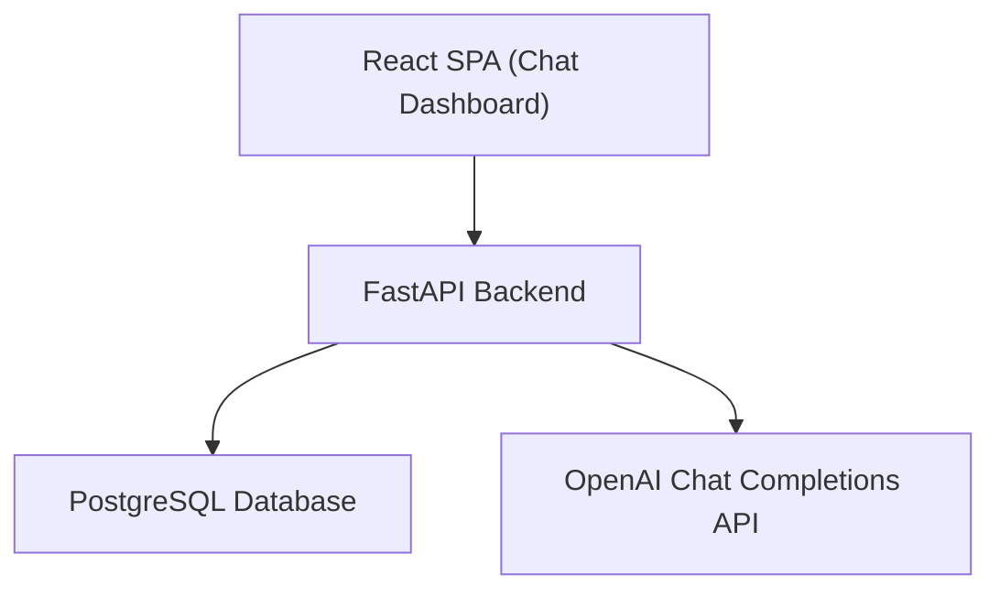
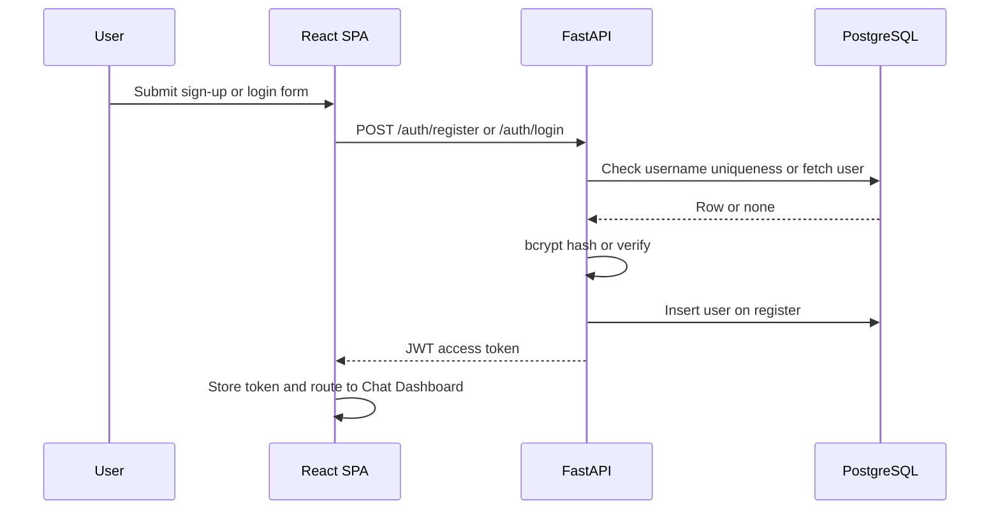
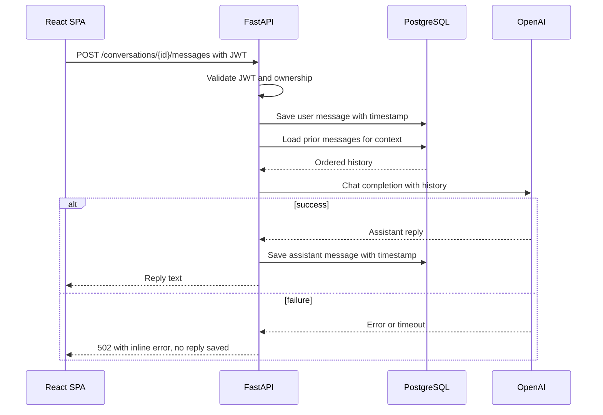
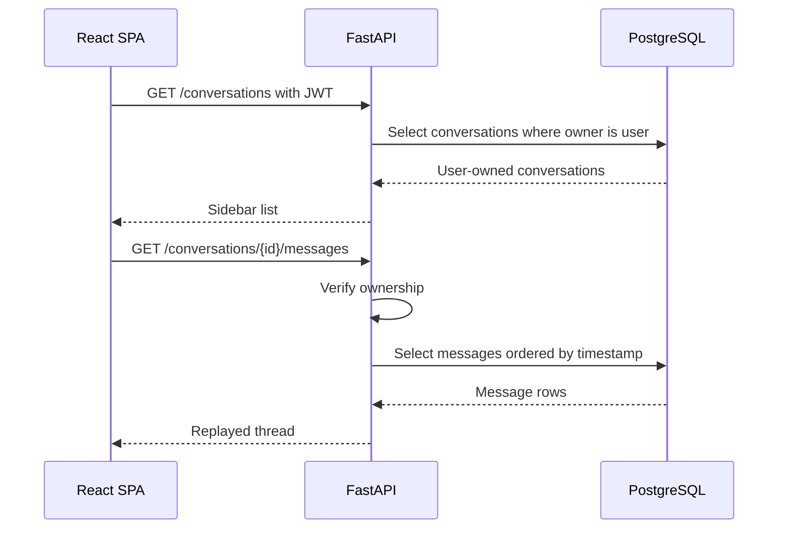
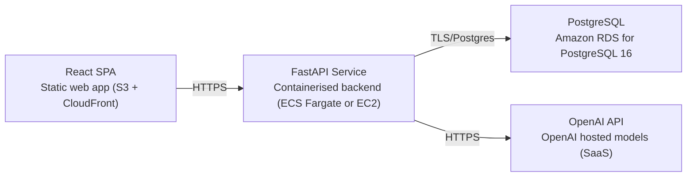

# Architecture

> Maintained by QuorQ AI SDLC. Text between `sdlc:auto` markers is regenerated; anything outside them is yours and is kept.

<!-- sdlc:auto:start narrative -->
## Overview

### ARCH-OVERVIEW · approved · source: architecture:overview

Approved v1 architecture: a React 19 SPA, FastAPI 0.115 backend, PostgreSQL 16, and OpenAI, deployed entirely on AWS, matching the approved requirements stack exactly.

Before auth only Login/Sign-up is reachable. After login the SPA holds a JWT and renders the Chat Dashboard (sidebar, thread, input, Send, Logout). Backend registers/authenticates users with bcrypt-hashed passwords, issues JWTs, enforces per-user conversation ownership in the database, persists every message with a timestamp, and calls OpenAI with prior conversation messages as context.

**Related:** EPIC-001, EPIC-002, EPIC-003, EPIC-004

### ARCH-COMP-FRONTEND · approved · source: architecture:components:frontend

React 19 SPA renders Login/Sign-up and the authenticated Chat Dashboard, holding the JWT client-side.

Responsibilities: render Login/Sign-up and Chat Dashboard (sidebar, thread, input, Send, Logout); store the JWT; guard routes so only Login shows pre-auth; show typing/pending and inline error states; communicate with the backend over HTTPS.

**Related:** EPIC-001, EPIC-002, EPIC-003, EPIC-004

### ARCH-COMP-BACKEND · approved · source: architecture:components:backend

FastAPI 0.115 backend exposes all auth and chat/conversation REST endpoints and enforces security rules.

Registers users with unique usernames; hashes passwords with bcrypt; verifies credentials; issues and validates JWTs; enforces per-user conversation ownership; persists messages with timestamps; assembles conversation context; calls OpenAI for replies.

**Related:** EPIC-001, EPIC-002, EPIC-003

### ARCH-COMP-DB · approved · source: architecture:components:database

PostgreSQL 16 stores users, conversations, and messages, enforcing uniqueness and ownership at the data layer.

Enforces unique usernames and owner-scoped access to conversations; persists chat history with timestamps so it survives refresh and re-login.

**Related:** EPIC-001, EPIC-003

### ARCH-COMP-OPENAI · approved · source: architecture:components:openai

OpenAI Chat Completions API is the hosted language model that generates assistant replies.

Generates the assistant's reply from the conversation's prior messages, which the backend supplies as context. Accessed only server-side using OPENAI_API_KEY.

**Related:** EPIC-002

### ARCH-PATH-AUTH · approved · source: architecture:critical_paths:register_login

Critical path: self-registration (unique username, bcrypt hash) followed by login issuing a JWT the SPA uses for all chat calls.

A visitor self-registers with a unique username and bcrypt-hashed password, then logs in to receive a JWT stored by the SPA and attached to all subsequent chat API calls.

**Related:** EPIC-001, REQ-US-001, REQ-US-002, REQ-US-003

### ARCH-PATH-CHAT · approved · source: architecture:critical_paths:send_message

Critical path: an authenticated send-message call validates JWT/ownership, persists the user message, calls OpenAI with prior context, and persists/returns the reply.

On failure, no assistant row is saved and an inline error is surfaced to the client -- matching the requirements-side AC-032 guarantee against fabricated replies.

**Related:** EPIC-002, REQ-US-008, REQ-US-009, REQ-US-011

### ARCH-PATH-CONVO · approved · source: architecture:critical_paths:conversation_management

Critical path: sidebar lists owner-scoped conversations most-recently-active first; selecting replays messages; New Chat/delete are owner-scoped and auto-titling happens on first message.

Selecting a conversation replays its messages; New Chat starts an empty thread auto-titled from the first message; delete removes a conversation and its messages, all scoped to the caller's ownership.

**Related:** EPIC-003, REQ-US-013, REQ-US-015, REQ-US-016, REQ-US-017

### ARCH-DATA-MODEL · approved · source: architecture:entities

Three-table data model: users, conversations, messages.

users(id, username, password_hash, created_at); conversations(id, user_id, title, created_at, updated_at); messages(id, conversation_id, role, content, created_at).

**Related:** EPIC-003

### ARCH-API · approved · source: architecture:endpoints

Seven REST endpoints cover auth and conversation/message management, all chat endpoints JWT-protected and owner-scoped.

POST /auth/register (409 on duplicate username, 422 on missing field); POST /auth/login (single generic error on bad credentials); GET /conversations (owner's list, most-recent-first); POST /conversations (create empty conversation); GET /conversations/{id}/messages (chronological replay, 404 if not owned); POST /conversations/{id}/messages (persist user message, call OpenAI with prior context, persist+return reply, 502 with inline error and no assistant row on model failure); DELETE /conversations/{id} (404/403 if not owned).

**Related:** EPIC-001, EPIC-002, EPIC-003

### ARCH-DEPLOY · approved · source: architecture:deployment_nodes

AWS deployment topology: static S3/CloudFront frontend, containerised FastAPI service, RDS PostgreSQL, and external OpenAI API.

React SPA served as a static web app via S3+CloudFront (Browser-rendered React 19 build). FastAPI service containerised on ECS Fargate or EC2, running Python 3.12 / FastAPI 0.115 / Uvicorn. PostgreSQL via Amazon RDS for PostgreSQL 16. OpenAI accessed as an external HTTPS SaaS API.

**Related:** REQ-STACK

- ⚠ Deployment nodes are a design, not a confirmed provisioned environment -- no deployment phase input exists yet confirming any of this has actually been stood up on AWS.

### ARCH-TECH-DECISIONS · approved · source: architecture:technology_decisions

Each stack choice was weighed against alternatives and selected for fit with this project's small, simplicity-favoured scope.

Frontend: React 19 over Vue/Svelte -- single SPA behind login, client-side JWT and route guarding. Backend: FastAPI 0.115 over Django REST Framework/Flask -- small auth+chat API, direct fit with OpenAI's Python library, Pydantic validation, JWT dependency guards. Database: PostgreSQL 16 over MySQL/SQLite -- three tables with FK-enforced ownership give persistence and per-user visibility. Cloud: AWS over Render/Fly.io -- one account runs backend, static frontend, and RDS Postgres with server-side OpenAI secret, staying at small-scale pricing for demo volume.

**Related:** REQ-STACK
<!-- sdlc:auto:end narrative -->

<!-- sdlc:auto:start building-blocks -->
## Building Block View

| ID | Name | Technology | Responsibility | Depends on |
|---|---|---|---|---|
| frontend | React SPA (Chat Dashboard) | React 19 | Renders Login/Sign-up and the authenticated Chat Dashboard (sidebar, thread, input, Send, Logout). Stores the JWT, guards routes so only Login shows when unauthenticated, shows typing/pending and inline error states, and talks to the backend over HTTPS. | backend |
| backend | FastAPI Backend | FastAPI 0.115 | Exposes auth and chat/conversation REST endpoints. Registers users with unique usernames, hashes passwords with bcrypt, verifies credentials, issues and validates JWTs, enforces per-user conversation ownership, persists messages with timestamps, assembles conversation context and calls OpenAI for replies. | database, openai |
| database | PostgreSQL Database | PostgreSQL 16 | Stores users, conversations and messages. Enforces unique usernames and owner-scoped access to conversations, persists chat history with timestamps so it survives refresh and re-login. | — |
| openai | OpenAI Chat Completions API | OpenAI (SaaS) | Hosted language model that generates the assistant's reply from the conversation's prior messages supplied by the backend. | — |

<!-- sdlc:auto:end building-blocks -->

<!-- sdlc:auto:start runtime -->
## Runtime View

### Register and log in

A visitor self-registers with a unique username and password (bcrypt-hashed), then logs in to receive a JWT the SPA stores and uses for all chat calls.

- **Components:** frontend, backend, database
- **Modules:** auth_router, security, user_repository
- **Key functions:** register(username, password), hash_password(password), login(username, password), verify_password(password, hash), create_access_token(user_id)

### Send message and get AI reply

An authenticated user sends a message. The backend validates the JWT and ownership, persists the user message, assembles the conversation's prior messages as context, calls OpenAI, persists the reply, and returns it. On failure no assistant row is saved and an inline error is surfaced.

- **Components:** frontend, backend, database, openai
- **Modules:** chat_router, conversation_service, message_repository, openai_client, auth_dependency
- **Key functions:** send_message(conversation_id, text, user), get_current_user(token), assemble_context(conversation_id), generate_reply(messages), save_message(conversation_id, role, text)

### List, replay and manage conversations

The sidebar lists the signed-in user's own conversations most-recently-active first. Selecting one replays its messages, New Chat starts an empty thread auto-titled from the first message, and delete removes a conversation and its messages, all owner-scoped.

- **Components:** frontend, backend, database
- **Modules:** conversation_router, conversation_service, conversation_repository
- **Key functions:** list_conversations(user), get_conversation_messages(conversation_id, user), create_conversation(user, first_message), derive_title(first_message), delete_conversation(conversation_id, user)

<!-- sdlc:auto:end runtime -->

<!-- sdlc:auto:start deployment-view -->
## Deployment View

| Name | Service | Runtime | Scaling | Environment |
|---|---|---|---|---|
| React SPA | Static web app (S3 + CloudFront) | Browser (React 19 build) | CDN edge, static | dev |
| FastAPI Service | Containerised backend (ECS Fargate or EC2) | Python 3.12 / FastAPI 0.115 / Uvicorn | Single small task at demo volume | dev |
| PostgreSQL | Amazon RDS for PostgreSQL 16 | PostgreSQL 16 | Single small instance | dev |
| OpenAI API | OpenAI hosted models (SaaS) | External HTTPS API | Provider-managed | dev |

| Source | Target | Protocol |
|---|---|---|
| React SPA | FastAPI Service | HTTPS |
| FastAPI Service | PostgreSQL | TLS/Postgres |
| FastAPI Service | OpenAI API | HTTPS |

<!-- sdlc:auto:end deployment-view -->

<!-- sdlc:auto:start decisions -->
## Architecture Decisions

| Layer | Choice | ADR |
|---|---|---|
| Frontend | React 19 | [ADR-0001](adr/frontend.md) |
| Backend | FastAPI 0.115 | [ADR-0002](adr/backend.md) |
| Database | PostgreSQL 16 | [ADR-0003](adr/database.md) |
| Cloud | AWS | [ADR-0004](adr/cloud.md) |
<!-- sdlc:auto:end decisions -->

<!-- sdlc:auto:start links -->
## Related Documents

- [Data Model](data-model.md)
- [API Specification](api/openapi.yaml)
- [Architecture Decision Records](adr/README.md)
<!-- sdlc:auto:end links -->
